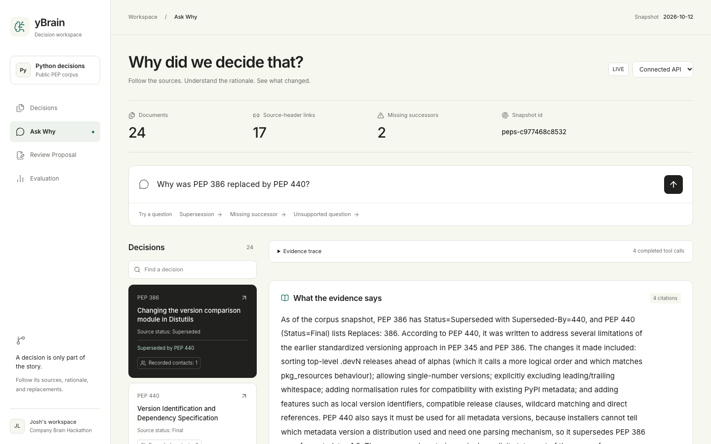

# yBrain

**Every team forgets why it made its decisions. yBrain remembers.**

yBrain (pronounced why-brain) is an AI assistant that answers one of the hardest questions at work: *"Why did we decide that?"* It connects your decisions, discussions, and owners, then shows you the full story behind every answer.



[Watch the demo](https://youtu.be/6P9EJdDR-Ew) · [Follow the demo walkthrough](docs/demo-script.md) · [Run it locally](#quick-start)

---

## The problem

Important decisions are scattered across documents, chat threads, and meeting notes. Months later, nobody remembers the reasoning, who was involved, or whether the decision still holds. New teammates ask the same questions again. Old decisions get followed long after they've been replaced.

## What yBrain does

- **Answers with the full story.** Ask a question in plain language and get a clear answer with sources.
- **Shows its work.** Every answer comes with a visual map of how the pieces connect, so you can see exactly where it came from.
- **Warns you about outdated decisions.** If a newer decision has replaced the one you're asking about, yBrain tells you and shows you the current reasoning.
- **Adapts to the person asking.** A maintainer gets the technical detail. A newcomer gets the context. Same facts, different emphasis.

## Highlights

**Answer trace.** Watch the connections light up as yBrain finds your answer.

**Graph vs. search.** See the same question answered two ways: by ordinary search, which returns disconnected snippets, and by yBrain, which returns a connected answer.

**Decision timeline.** Follow any decision from its first proposal through every change, to where it stands today. Replaced decisions are clearly marked.

**Knowledge health map.** Spot topics that are out of date or known by only one person, before they become a problem.

**Role-based answers.** Compare how the same answer changes for different people on your team.

## See it in action

Our demo uses the public Python Enhancement Proposals (PEPs), a real record of design decisions made over many years. Try asking:

> *Why does Python handle this feature the way it does?*

Ordinary search returns the original proposal, which was later replaced. yBrain finds the replacement, flags the older proposal as outdated, and shows the path between them.

Bring your own data: architecture decision records, RFCs, meeting notes, Slack threads, and tickets all work the same way.

## How it works

1. **Collect.** Your documents, messages, and tickets are stored in [HydraDB](https://hydradb.com).
2. **Connect.** Decisions, people, and teams are linked by how they relate, such as who proposed what and what replaced what.
3. **Ask.** yBrain finds the relevant passages and follows the connections between them.
4. **Show.** You get a clear answer, a visual map, and a warning if anything is out of date.

## Quick start

Requirements: Node.js 20.9+, npm, and (for the backend) Python 3.11+ and [uv](https://docs.astral.sh/uv/).

```bash
git clone https://github.com/joshlaubach/10_12_hackathon_whybrain.git
cd 10_12_hackathon_whybrain
cd apps/web
npm ci
npm run dev
```

Open http://localhost:3100. With no API URL configured, the app starts in **Mock playback**, uses the committed PEP fixtures, and displays **Mock data**. No API keys are needed for this walkthrough.

For real model answers, configure the backend from the repository root:

```bash
cp .env.example .env
# Add HYDRADB_API_KEY and ANTHROPIC_API_KEY to .env; never commit it.
uv sync --project apps/api
scripts/run_demo.sh
```

The PEP API runs on http://localhost:8000. In a second terminal:

```bash
cd apps/web
NEXT_PUBLIC_API_URL=http://localhost:8000 npm run dev
```

The UI starts in **Connected API**. Only the API URL belongs in the web environment; provider keys stay in the backend. LIVE answers require the PEP corpus to be ingested into the configured HydraDB collection. To populate that collection, ingest once with `uv run --project apps/api python scripts/ingest.py --collection wb_demo --workers 4`; this uploads the committed PEP snapshot and may take several minutes.

The fictional Maple Street Café corpus uses a separate API process on :8002 and a web process on :3000. See [the café run instructions](docs/web.md#separate-café-workspace-draft-branch-do-not-merge-before-430-pt). Answers report the evidence mode actually used; draft proposals remain separate from accepted records.

## Built with

- [HydraDB](https://hydradb.com) for memory, knowledge graph, and retrieval
- [Anthropic Claude](https://www.anthropic.com) (Sonnet) for the agent that composes cited answers
- Python, FastAPI and Pydantic for the backend and the API contract
- Next.js, React and TypeScript for the interface

## What's next

- Live connections to Slack, Notion, GitHub, and Jira
- Alerts when a new decision conflicts with an existing one
- Team-wide digests of outdated knowledge

## About

yBrain was created for the Company Brain Hackathon.

Built by [Josh Laubach](https://github.com/joshlaubach).

## License

MIT
